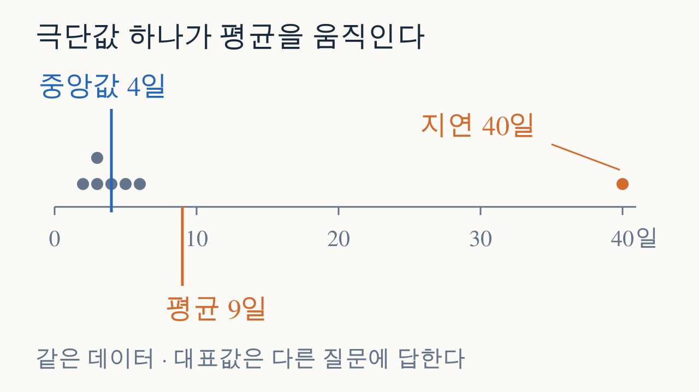
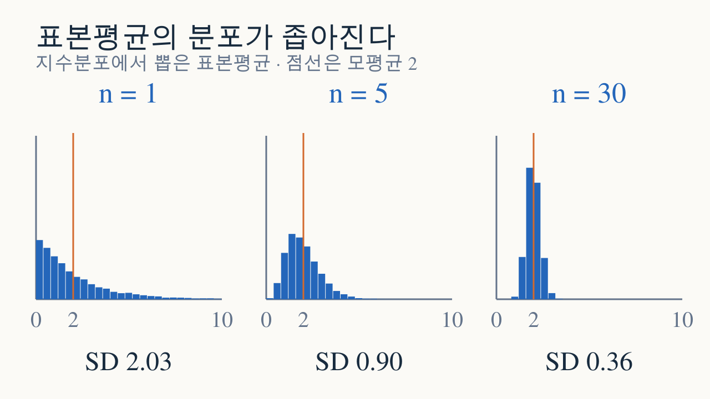

# 데이터 분석을 위한 통계 기초: 요약에서 추론까지

평균 하나는 데이터를 요약하지만, 그 평균을 얼마나 믿을 수 있는지는 알려주지 않는다. 통계 분석에서는 **중심과 퍼짐 → 표본이 모인 방식 → 분포 → 추정의 불확실성 → 검정**을 함께 살펴봐야 한다.

이 글은 대표값과 변이, 표본 추출과 편향, 정규분포와 중심극한정리, 신뢰구간과 가설 검정, 독립·대응 표본 t-검정을 연결한다. 마지막에는 [A/B 테스트](1007_AB테스트와비율검정.md)에서 이 개념들이 어떻게 쓰이는지 이어진다.

## 1. 대표값은 어떤 질문에 답하는가?

온라인 주문의 배송 기간이 다음과 같다고 하자. 단위는 일이며 설명을 위해 만든 데이터다.

```text
2, 3, 3, 4, 5, 6, 40
```

평균은 9일, 중앙값은 4일이다. 대부분은 2일부터 6일에 도착하지만 40일인 주문 하나가 평균을 끌어올렸다. 두 값 중 하나가 틀린 것이 아니라, **평균은 전체 합의 크기를 반영하고 중앙값은 가운데 위치를 나타낸다.**



| 통계량 | 계산 또는 의미 | 유용한 질문과 주의점 |
|---|---|---|
| 평균 | 값의 합 / 개수 | 총량을 개수로 나눴을 때의 수준. 극단값에 민감하다. |
| 중앙값 | 정렬한 값의 가운데 위치 | 전형적인 가운데 값. 짝수 개라면 가운데 두 값의 평균을 쓴다. |
| 절사평균 | 양쪽 극단 일부를 제외한 평균 | 극단값의 영향을 줄인 중심. 제외 비율을 명시해야 한다. |
| 가중평균 | `Σ(wᵢxᵢ) / Σwᵢ` | 그룹의 크기나 중요도가 다를 때. 가중치의 의미가 필요하다. |
| 가중 중앙값 | 누적 가중치가 전체의 절반에 이르는 위치 | 관측별 비중이 다른 데이터의 가운데 위치. 경계에서의 정의를 명시한다. |
| 백분위수 | 정렬한 데이터에서 특정 비율의 위치 | 상위 지연 구간 등을 보고 싶을 때. 보간 방식에 따라 값이 달라질 수 있다. |

이 예제에서 가장 작은 값과 가장 큰 값을 하나씩 제외하면 절사평균은 4.2일이다. 배송 지연을 비용으로 계산하려면 평균이 필요할 수 있고, 일반 고객이 경험하는 배송 기간을 설명하려면 중앙값과 백분위수가 더 도움이 될 수 있다. 극단값이 있다는 이유만으로 자동 삭제하지 않는다. 입력 오류인지 실제 지연인지부터 확인한다.

## 2. 같은 평균이어도 퍼짐은 다르다

`4, 4, 4`와 `1, 4, 7`의 평균은 모두 4다. 두 번째 데이터는 값이 더 넓게 퍼져 있다.

모집단 전체의 분산과, 표본으로 모집단 분산을 추정하는 표본분산은 분모가 다르다.

```text
모분산      σ² = Σ(xᵢ - μ)² / N
표본분산    s² = Σ(xᵢ - x̄)² / (n - 1)
표본표준편차 s = √s²
사분위범위  IQR = Q3 - Q1
```

표본 평균을 데이터로 추정하면서 자유도 하나가 사용되므로, 통상적인 불편 표본분산에서는 `n - 1`로 나눈다. 분산의 단위는 원래 단위의 제곱이고, 표준편차는 원래 단위와 같다.

배송 예제의 표본표준편차는 약 13.7356일이다. 반면 NumPy의 선형 보간 분위수로 계산한 Q1은 3, Q3는 5.5, IQR은 2.5일이다. 표준편차는 40일인 관측에 크게 영향을 받고, IQR은 가운데 50%의 퍼짐을 보여 준다.

```python
import numpy as np

x = np.array([2, 3, 3, 4, 5, 6, 40], dtype=float)
print(x.mean())                       # 9.0
print(np.median(x))                    # 4.0
print(x.std(ddof=1))                   # 13.73559851869101
q1, q3 = np.quantile(x, [0.25, 0.75])
print(q1, q3, q3 - q1)                 # 3.0 5.5 2.5
```

`np.std`의 기본 `ddof=0`은 분모가 `n`이다. 표본분산·표본표준편차가 필요하면 `ddof=1`을 명시한다.

## 3. 표본을 많이 모으기 전에, 누구를 모았는지 확인한다

모집단은 알고 싶은 전체 대상이고 표본은 실제 조사한 일부다. “전체 고객의 만족도”를 알고 싶은데 단골 회원에게만 설문을 보내면, 관측 수가 많아도 전체 고객을 대표하지 못할 수 있다.

| 방법 | 어떻게 추출하는가? | 살펴볼 조건 |
|---|---|---|
| 단순 무작위 추출 | 정해진 크기의 표본을 가능한 표본들에서 같은 확률로 선택 | 표본틀에 누락된 사람이 없는가? |
| 층화 추출 | 연령·지역 등 층마다 표본을 추출 | 층별 표본 비중과 모집단 비중이 다른 경우 가중치를 고려한다. |
| 계통 추출 | 무작위 시작점부터 일정 간격으로 선택 | 데이터 순서의 주기성과 간격이 겹치지 않는가? |
| 군집 추출 | 학교·지역 같은 군집을 선택해 조사 | 같은 군집 내 관측의 유사성을 분석에서 고려한다. |
| 편의 추출 | 접근하기 쉬운 사람부터 선택 | 조사 대상 밖으로 일반화하는 데 제한이 크다. |

복원 추출은 선택한 대상을 다시 넣어 중복 선택을 허용하고, 비복원 추출은 같은 대상을 한 번만 선택한다. 무작위 추출은 추출 규칙이 없는 것이 아니라 **확률적인 선택 규칙이 있는 것**이다.

표본오차는 우연한 표본 선택 때문에 추정값이 흔들리는 현상이다. 적절한 설계에서는 표본 수를 늘려 줄일 수 있다. 선택 편향은 포함·응답·탈락 과정이 특정 대상을 체계적으로 배제해 결과를 왜곡하는 문제다. 표본 수를 늘리는 것만으로 해결되지 않는다. 비표본오차에는 편향뿐 아니라 측정·기록상의 우연한 오류도 포함된다.

표본 편향과 선택 편향은 용어의 사용 범위가 겹친다. 두 용어를 기계적으로 구분하기보다, **누가 빠졌고 어떤 과정에서 빠졌는지**를 설명하는 편이 중요하다. 무작위로 뽑았더라도 일부 집단이 응답하지 않으면 편향이 남을 수 있다.

## 4. 분포는 평균이 놓친 모양을 보여 준다

| 도구 | 읽는 내용 | 주의점 |
|---|---|---|
| 히스토그램 | 구간별 빈도, 비대칭, 여러 봉우리 | 구간 폭과 시작점에 따라 모습이 달라진다. |
| 박스플롯 | 중앙값, Q1부터 Q3, 수염, 별도 표시된 관측 | 수염의 정의는 구현에 따라 다르다. |
| 밀도 곡선(KDE) | 관측에서 추정한 매끄러운 밀도 | 대역폭에 따라 모양이 달라지며 실제 확률분포를 증명하지 않는다. |
| Q-Q 플롯 | 이론 분포와 관측 데이터 분위수의 대응 | 점이 직선에 가까운지, 특히 꼬리에서 벗어나는지 본다. |

흔한 박스플롯 규칙은 `Q1 - 1.5×IQR`과 `Q3 + 1.5×IQR` 안에 있는 가장 먼 관측까지 수염을 그리는 것이다. 따라서 수염 끝이 항상 최솟값·최댓값인 것은 아니다. 수염 밖의 점도 자동으로 오류가 되지는 않는다. [NIST 박스플롯 설명](https://www.itl.nist.gov/div898/handbook/eda/section3/boxplot.htm)

확률분포는 가능한 값과 그 가능성을 나타내는 모델이다. 이항분포·포아송분포는 이산형이고 정규분포·지수분포는 연속형이다. 연속형 분포에서 한 점의 밀도 높이는 그 점의 확률이 아니다. 구간 아래의 면적이 구간 확률이다.

정규분포는 평균 μ와 표준편차 σ로 모양이 결정되는 대칭적인 종 모양 분포다. 정규분포에 한해 평균 주변 ±1σ, ±2σ, ±3σ 안에 각각 약 68.3%, 95.4%, 99.7%가 들어간다. 모든 실무 데이터에 이 비율을 적용할 수는 없다. 표준화 `z=(x-μ)/σ`는 위치와 단위를 바꾸는 것이며 데이터의 모양을 정규분포로 바꾸는 작업이 아니다.

## 5. 중심극한정리는 원자료를 정규분포로 만들지 않는다

원자료의 분포와 **여러 표본에서 구한 평균의 분포**는 다르다. 표본평균이라는 통계량이 반복 추출에서 만드는 분포를 표본분포 또는 표집분포라고 부른다.

고전적인 중심극한정리는 독립·동일분포이고 분산이 유한한 관측에 대해, 표준화한 표본평균의 분포가 표본 수 증가에 따라 표준정규분포에 가까워진다는 정리다.

```text
E(x̄) = μ
SE(x̄) = σ / √n
( x̄ - μ ) / ( σ / √n ) ≈ N(0, 1)
```

표준편차는 개별 값의 퍼짐이고, 표준오차(SE)는 추정 통계량의 흔들림이다. 표본 수를 4배로 늘리면 독립 관측이라는 조건 아래 평균의 표준오차는 절반이 된다.



평균·표준편차가 모두 2인 지수분포에서 표본을 뽑아 평균을 10,000회씩 계산했다. 아래는 자동화 도구로 실행한 자체 시뮬레이션 결과다.

| 각 표본의 크기 n | 반복된 표본평균의 평균 | 반복된 표본평균의 표준편차 | 이론 표준오차 `2/√n` |
|---:|---:|---:|---:|
| 1 | 2.0210 | 2.0293 | 2.0000 |
| 5 | 2.0010 | 0.8975 | 0.8944 |
| 30 | 2.0022 | 0.3625 | 0.3651 |

```python
import numpy as np

rng = np.random.default_rng(20261006)
for n in [1, 5, 30]:
    samples = rng.exponential(scale=2, size=(10000, n))
    means = samples.mean(axis=1)
    print(n, means.mean(), means.std(ddof=1))
```

원자료는 계속 오른쪽 꼬리가 긴 지수분포다. 평균들의 분포가 더 대칭적이고 좁아지는 것이다. `n=30`은 모든 분포와 데이터 구조에 적용되는 보장 기준이 아니다. 강한 비대칭·극단값·종속성에서는 근사 품질을 따로 확인해야 한다. 시계열에서 연속된 30개 관측이 독립이라고 자동으로 가정할 수도 없다.

## 6. 신뢰구간은 추정 절차의 불확실성을 표현한다

모집단 표준편차를 모르고, 독립적인 정규 모집단 표본으로 평균을 추정한다면 다음 t 신뢰구간을 쓴다. 큰 표본에서 정규근사가 적절한 경우에는 근사적으로 활용할 수 있다.

```text
평균의 95% 신뢰구간 = x̄ ± t(0.975, n-1) × s/√n
```

표본표준편차 `s`까지 데이터에서 추정한 불확실성을 반영하는 t분포는 표준정규분포보다 꼬리가 두껍고, 자유도가 커지면 표준정규분포에 가까워진다. t분포를 쓴다고 모든 극단값이나 종속성 문제가 해결되는 것은 아니다.

빈도주의에서 “95% 신뢰구간”은 같은 방법으로 반복 추출해 구간을 만들면 장기적으로 약 95%의 구간이 참 모수를 포함한다는 뜻이다. 이미 계산한 한 구간에 고정된 모수가 들어갈 확률이 95%라는 뜻은 아니다. [NIST 신뢰구간 해석](https://www.itl.nist.gov/div898/handbook/prc/section1/prc14.htm)

개별 배송 기간을 예측하는 구간과 전체 평균을 추정하는 신뢰구간도 다르다. 평균의 신뢰구간이 좁다고 모든 고객의 배송 기간이 비슷한 것은 아니다. 평균의 t 신뢰구간 계산식은 [NIST 평균 신뢰구간](https://www.itl.nist.gov/div898/handbook/eda/section3/eda352.htm)에서 확인할 수 있다.

## 7. p-value는 무엇을 가정한 확률인가?

독립적인 A·B 집단의 평균 차이 Δ를 검정한다고 하자.

```text
양측: H0: Δ = 0, H1: Δ ≠ 0
단측: H0: Δ ≤ 0, H1: Δ > 0  (B가 더 크다는 방향)
```

방향과 유의수준 α는 데이터를 보기 전에 정한다. p-value는 **귀무가설과 분석 모형의 가정을 전제로, 관측된 검정통계량만큼 또는 더 극단적인 결과가 나올 확률**이다. 귀무가설이 참일 확률, 차이가 우연일 확률, 새 기능이 성공할 확률을 직접 나타내지 않는다.

`p < α`이면 귀무가설을 기각한다. `p ≥ α`이면 기각할 근거가 충분하지 않다. 이를 “두 집단이 같다” 또는 “차이가 없다”의 증명으로 바꾸면 안 된다. p-value는 효과의 크기도 알려주지 않으므로 추정 차이와 신뢰구간을 함께 보고한다.

| 실제 상태 | H0를 기각하지 않음 | H0를 기각함 |
|---|---|---|
| H0가 참 | 올바른 판단 | 1종 오류: 없는 차이를 발견했다고 판단 |
| H0가 거짓 | 2종 오류: 있는 차이를 놓침 | 차이를 검출 |

유의수준은 가정과 검정 절차가 맞을 때 H0가 참인 상황에서의 1종 오류 확률을 통제하는 기준이다. 검정력 `1-β`는 정해진 실제 효과가 있을 때 이를 검출할 확률이다. 다른 조건을 유지하면서 α를 더 낮추면 검정력은 낮아질 수 있다.

같은 모형·방법에서 얻은 양측 검정과 대응하는 신뢰구간이라면, 95% 차이 구간이 0을 제외하는 것과 유의수준 5%에서의 기각이 연결된다. 서로 다른 근사법·단측 검정·다중 비교 보정 결과를 무조건 같은 것으로 비교하면 안 된다.

## 8. t-검정은 표본의 관계부터 고른다

| 데이터 구조 | 방법 | 핵심 조건 |
|---|---|---|
| 한 집단 평균과 기준값 | 일표본 t-검정 | 관측 독립성, 평균 추론에 적절한 분포 |
| 서로 다른 두 집단 | 독립 표본 t-검정 | 집단 간·관측 간 독립성 |
| 독립 두 집단, 등분산을 가정하지 않음 | Welch t-검정 | 각 집단 분산을 따로 추정하며 독립성은 여전히 필요 |
| 같은 대상의 전후 측정 | 대응 표본 t-검정 | 대상별 짝 연결, 대상 간 독립성, **차이값**의 분포 |

등분산 독립 t-검정은 두 집단 분산을 통합한다. Welch 검정은 평균 차이의 표준오차를 `√(sA²/nA + sB²/nB)`로 계산한다. 표본 수와 변동성이 결과에 함께 영향을 준다. [SciPy 독립 표본 t-검정](https://docs.scipy.org/doc/scipy/reference/generated/scipy.stats.ttest_ind.html)

Shapiro–Wilk 검정은 정규분포라는 가설을, Levene 검정은 집단의 분산이 같다는 가설을 살펴본다. 두 검정에서 큰 p-value가 나왔다고 정규성·등분산이 증명되는 것은 아니다. 표본이 작으면 문제를 검출하기 어렵고, 크면 작은 일탈도 검출할 수 있다. Q-Q 플롯·극단값·관측 설계를 함께 확인한다. 사전검정 결과 하나로 분석 방법을 자동 선택하는 대신, 독립성·비교 대상·분포 가정에 맞춰 방법을 정한다.

### 독립 두 집단의 자체 계산 예제

```python
import numpy as np
from scipy import stats

a = np.array([42, 45, 46, 47, 48, 50, 52, 54], dtype=float)
b = np.array([44, 48, 50, 52, 55, 58, 60, 65], dtype=float)
result = stats.ttest_ind(b, a, equal_var=False)  # B - A 방향
print(b.mean() - a.mean())
print(result.statistic, result.pvalue)
print(result.confidence_interval())
```

실행 결과는 평균 차이 6.0, `t≈2.1503`, 양측 `p≈0.05445`, 95% 차이 신뢰구간 `[-0.1362, 12.1362]`다. 5% 기준에서는 기각하지 못한다. **관측 평균은 B가 높지만, 이 작은 표본으로 평균 차이를 충분히 확정하지 못한 것**이다. 이 고정 데이터는 계산 설명용이며 실제 집단의 정규성이나 실험 효과를 검증한 결과는 아니다.

### 대응 표본은 짝별 차이를 본다

```python
before = np.array([20, 22, 19, 25, 24, 21, 23, 26], dtype=float)
after = np.array([18, 21, 17, 23, 22, 20, 20, 24], dtype=float)
difference = after - before
result = stats.ttest_rel(after, before)
print(difference.mean())             # -1.875
print(result.statistic, result.pvalue)
```

실행 결과 `t≈-8.2752`, `p≈7.3402e-05`다. 각 대상의 변화량으로 추론하므로, 전후 두 배열의 정규성을 따로 보는 것보다 차이값의 분포가 중요하다. 순서를 바꾸면 차이와 t값의 부호도 바뀐다. [SciPy 대응 표본 t-검정](https://docs.scipy.org/doc/scipy/reference/generated/scipy.stats.ttest_rel.html)

전후 차이가 유의해도 대조군 없는 관측에서는 시간 추세와 다른 변화가 영향을 줬을 수 있다. 대응 검정만으로 변화의 원인을 특정 처치로 확정할 수 없다.

위 코드는 Python 3.11.9, NumPy 2.4.6, SciPy 1.17.1에서 자동화 도구로 실행했다. 시뮬레이션은 명시한 시드·분포·반복 범위에 대한 관찰이며 모든 데이터에 대한 보장은 아니다.

## 복습 질문

1. 평균 9일과 중앙값 4일은 왜 동시에 맞을 수 있는가?
2. 표본을 4배로 늘렸을 때 표준오차와 선택 편향은 각각 어떻게 달라지는가?
3. 중심극한정리에서 정규분포에 가까워지는 대상은 무엇인가?
4. p-value가 0.2이면 “두 집단이 같다”고 결론 내릴 수 있는가?
5. 같은 고객의 전후 측정에서 어떤 데이터의 분포를 확인해야 하는가?

다음 글에서는 이 불확실성의 관점을 [사용자 배정·전환율·A/B 테스트 의사결정](1007_AB테스트와비율검정.md)에 적용한다.
