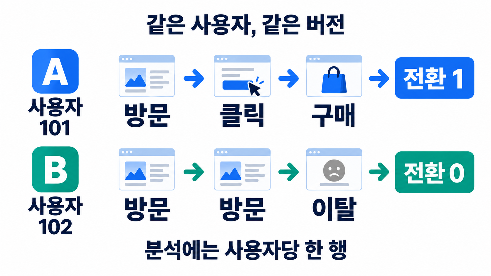
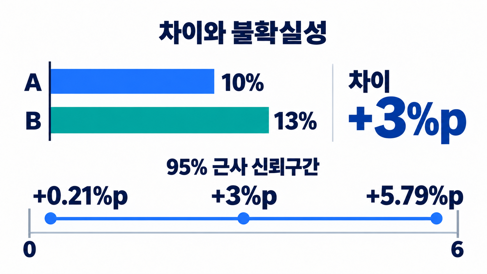

# A/B 테스트: 실험 설계부터 비율 검정과 의사결정까지

새 결제 화면에서 구매율이 높게 나왔다는 사실만으로 화면 변경의 효과를 확정할 수는 없다. 사용자 구성이 달랐거나, 로그가 일부 빠졌거나, 작은 표본에서 우연히 큰 차이가 보였을 수 있다.

A/B 테스트는 같은 기간의 사용자를 무작위로 나눠 기존 버전 A와 변경 버전 B를 비교하는 실험이다. 핵심은 **비교 가능한 배정 → 일관된 관측 → 적절한 분석 단위 → 차이와 불확실성 → 도입 판단**이다. [통계 기초](1006_데이터분석통계기초.md)의 표본·표준오차·가설 검정이 여기서 하나의 흐름으로 연결된다.

## 1. 현황 분석과 실험은 답하는 질문이 다르다

| 분석 | 답하는 질문 | 해석의 범위 |
|---|---|---|
| 기술 통계 | 현재 구매율은 얼마인가? | 관측된 현상을 요약한다. |
| 탐색적 분석(EDA) | 어떤 사용자·행동에서 구매율이 다른가? | 패턴과 가설을 찾는다. 연관만으로 원인을 확정하지 않는다. |
| 예측 | 이 사용자가 구매할 가능성은 얼마인가? | 정의된 조건에서 미래 결과를 예측한다. |
| 실험 | 이 변경이 구매율을 높이는가? | 무작위 배정 등 조건을 갖추면 변경의 인과 효과를 추정한다. |

관측 데이터에서 새 기능을 이용한 사람과 이용하지 않은 사람을 비교하면, 원래 구매 의지가 높은 사람이 새 기능도 더 많이 이용했을 수 있다. 무작위 배정은 이런 특성이 특정 버전에 체계적으로 몰리는 것을 줄인다. 한 번의 실험에서 모든 특성이 정확히 같아지는 것은 아니므로 표본 변동과 데이터 품질을 확인해야 한다.

실험 참여자에 대한 효과를 추정했다고 모든 시장·계절·사용자 집단에 같은 효과가 있다고 보장할 수도 없다. 대상 사용자의 선정과 그 안에서의 A/B 배정은 서로 다른 문제다.

## 2. 가설은 변경·행동·지표를 함께 정한다

“화면을 바꾸면 좋아질 것이다”보다 다음처럼 구체적인 가설이 좋다.

> 결제 입력 단계를 줄이면 결제 중 이탈이 줄어, 배정된 사용자 중 구매한 사용자의 비율이 증가할 것이다.

실험 전에 아래 사항을 문서로 정한다.

- 변경 대상과 대조 버전: B에서 무엇을 바꾸고 A는 무엇을 제공하는가?
- 대상과 배정 단위: 사용자·기기·팀 중 누구를 한 단위로 나누는가?
- 주요 지표(Primary Metric): 성공을 판단할 한 가지 핵심 지표는 무엇인가?
- 보호 지표(Guardrail Metric): 오류율·환불률·지연 시간 등 어떤 악화를 막을 것인가?
- 최소 탐지 효과(MDE), 유의수준, 검정력, 단측/양측 여부, 표본 수와 종료 규칙.
- 분석 기간, 구매 관측 기간, 제외 조건, 누락·중복 처리 방식.

MDE는 탐지하고 싶은 최소 효과 크기다. 검정력은 그 크기의 실제 효과가 있을 때 이를 탐지할 확률이다. 효과가 작을수록, 목표 검정력이 높을수록 일반적으로 더 많은 표본이 필요하다. 트래픽이 부족하거나 비교 대상을 정의할 수 없다면 먼저 관측·설계부터 보완한다. 명백한 오류를 고치는 데 실험상의 우승 판정이 반드시 필요한 것도 아니다.

두 버전 비교가 A/B이고, 여러 버전 비교는 A/B/n, 여러 요소의 조합을 함께 다루면 다변량 실험이다. 밴딧은 보상에 따라 배정 비율을 바꾸므로 고정 배정 실험과 추론 방법이 달라질 수 있다. 장기 효과를 보려면 일부 대상을 기존 버전으로 유지하는 홀드아웃도 고려한다. 방식이 달라지면 설계·분석도 함께 달라져야 한다.

## 3. 같은 사용자는 같은 그룹에 남아야 한다



*사용자 101은 A, 사용자 102는 B에 고정 배정한 설명용 예시. 구매 여부는 사용자당 1행으로 집계한다.*

로그인 사용자라면 `user_id`, 비로그인 방문자라면 기기·쿠키 ID 등을 사용할 수 있다. 하나의 사용자가 여러 기기로 방문하거나 쿠키를 지울 때 배정이 바뀔 수 있으므로, 선택한 ID가 무엇을 대표하는지 명시한다.

동적 배정에서도 안정적인 해시를 사용하면 같은 실험·사용자 조합에 동일한 버전을 제공할 수 있다. 아래는 설명용 50:50 버킷 예제다.

```python
import hashlib
import json

def assign_variant(experiment_id, user_id):
    payload = json.dumps(
        [str(experiment_id), str(user_id)],
        ensure_ascii=False,
        separators=(",", ":"),
    ).encode("utf-8")
    digest = hashlib.sha256(payload).digest()
    bucket = int.from_bytes(digest[:8], "big") % 100
    if bucket < 50:
        return "A"
    return "B"
```

문자열을 구분 없이 이어 붙이는 대신 배열로 인코딩해 ID 경계를 보존했다. Python 내장 `hash()`는 문자열에 대해 실행마다 값이 달라질 수 있으므로 지속되는 실험 배정에 그대로 쓰지 않는다. 안정적인 인코딩·해시·실험 ID와 버킷 경계를 유지해야 한다. [Python 해시 정책](https://docs.python.org/3/reference/datamodel.html#object.__hash__), [hashlib 공식 문서](https://docs.python.org/3/library/hashlib.html)

배정 비율을 실험 도중 바꾸면 경계 근처의 사용자가 다른 그룹으로 이동할 수 있다. 단계적으로 트래픽을 늘릴 때도 기존 배정을 유지할 장치가 필요하다. 같은 사용자가 다른 사용자의 결과에 영향을 주는 협업 서비스에서는 사용자 단위 독립성도 깨질 수 있다. 이런 경우 팀 단위 배정 등 다른 설계가 필요하다.

## 4. 배정 로그와 행동 로그를 구분한다

배정 로그에는 `experiment_id`, `user_id`, `variant`, `assigned_at` 등을 남긴다. 이벤트 로그에는 이벤트 ID·사용자 ID·발생 시각·노출·클릭·구매·금액을 남긴다. 배정되었다는 사실과 실제로 화면에 노출되었다는 사실은 같지 않다.

분석은 대략 다음 순서로 진행한다.

```text
배정 로그 + 이벤트 로그
→ 실험/사용자/시간 조건에 맞게 연결
→ 이벤트 중복 제거
→ 사용자별 관측 기간 안의 행동 집계
→ 실험별·사용자별 1행
→ 그룹 지표와 통계량 계산
```

한 사용자의 배정이 여러 행이고 이벤트도 여러 행인데 그대로 연결하면 행이 곱해져 매출·클릭 수가 중복될 수 있다. 사용자별 집계 기준과 배정 기록의 유일성을 확인한다. 구매 시각은 배정 이후이며 사전에 정한 관측 기간 안에 있어야 한다.

사용자 전환율을 평가할 때는 배정된 분석 대상 중 이벤트가 없는 사용자도 분모에 포함하도록 설계한다. 구매 이벤트가 있는 사용자만 내부 조인하면 미구매 사용자가 사라져 구매율이 왜곡된다. 다만 로그 누락으로 관측하지 못한 경우를 실제 미구매인 0으로 무조건 대체해서도 안 된다.

노출된 사용자만 분석하는 조건은 사전에 정의하고 양 그룹에 같은 방식으로 관측할 수 있어야 한다. 새 기능이 노출·클릭 자체를 바꾸는데 클릭한 사용자만 남기면, 처치 이후 행동으로 표본을 선택하는 편향이 생길 수 있다.

## 5. 비율 지표의 분모와 분석 단위를 먼저 정한다

성공/실패를 1과 0으로 표현하는 한 번의 관측이 베르누이 시행이다. 독립적이고 성공 확률이 같은 n번의 시행에서 성공 횟수 X는 이항분포를 따른다.

```text
X ~ Binomial(n, p)
표본비율 p̂ = X/n
표준오차 SE(p̂) = √[p(1-p)/n]
```

사용자별 구매 여부라면 한 사용자를 한 번의 시행으로 볼 수 있다. 그러나 같은 사용자의 여러 노출을 독립적인 시행으로 세면 불확실성을 과소평가할 수 있다.

| 지표 | 이 글에서의 정의 | 분석 시 주의점 |
|---|---|---|
| 사용자 구매 전환율(CVR) | 구매한 고유 사용자 수 / 분석 대상 고유 사용자 수 | 주문 수와 구매한 사용자 수를 구분한다. |
| 이벤트 클릭률(CTR) | 클릭 이벤트 수 / 노출 이벤트 수 | 같은 사용자의 반복 이벤트는 종속적일 수 있다. |
| 사용자당 매출(ARPU) | 총매출 / 분석 대상 고유 사용자 수 | 미구매자의 0도 포함한다. |
| 배정 비율 | B에 배정된 고유 사용자 수 / 전체 배정 고유 사용자 수 | 구매율과는 다른 가설을 검정한다. |

CVR이라는 이름만으로 분모가 정해지지 않는다. 서비스마다 방문자·세션·노출 등 정의가 다를 수 있으므로 계산식과 관측 기간을 함께 적는다. 사용자당 매출과 구매자당 평균 주문 금액도 서로 다른 지표다.

## 6. 성과를 보기 전에 A/A와 SRM을 확인한다

A/A 테스트는 동일한 버전을 두 그룹에 제공해 배정·로그·지표 계산이 일관되는지 확인한다. 동일한 버전이어도 검정의 1종 오류 때문에 일부 지표는 우연히 유의할 수 있다. 한 번의 A/A에서 모든 p-value가 반드시 크다고 요구하면 안 된다. 반복된 실험에서 거짓 양성 빈도, 배정 중복, 누락과 집계 일관성을 확인한다.

SRM(Sample Ratio Mismatch)은 **관측된 배정 사용자 수가 계획한 배정 비율에서 통계적으로 크게 벗어나는 현상**이다. 50:50 실험뿐 아니라 80:20 등 계획한 비율과 비교한다.

총 10,000명에게 50:50 배정을 계획했는데 A 4,800명, B 5,200명이 관측되었다고 하자.

```text
H0: B에 배정되는 비율 p = 0.5
관측 비율 = 0.52
SE0 = √[0.5×0.5/10000] = 0.005
Z = (0.52 - 0.5)/0.005 = 4
양측 p ≈ 0.00006334
```

같은 기대 비율에 대한 카이제곱 적합도 검정으로도 확인할 수 있다.

```python
from scipy import stats

result = stats.chisquare([4800, 5200], f_exp=[5000, 5000])
print(result.statistic, result.pvalue)
# 16.0 6.33424836662399e-05
```

이 작은 p-value는 원인을 특정하지 않는다. 배정 구현, ID 변경, 로그 탈락, 분석 필터·조인 등을 조사해야 한다. 운영에서 쓸 SRM 경보 임계값은 별도로 정하고 반복 모니터링도 고려한다. [Microsoft Research의 SRM 진단](https://www.microsoft.com/en-us/research/articles/diagnosing-sample-ratio-mismatch-in-a-b-testing/)

**구매 수나 노출 수가 같아야 하는 것은 아니다.** B가 사용자의 행동을 바꿨다면 노출 수가 달라질 수 있다. 사용자 배정의 무결성과 행동 지표의 변화는 구분해서 본다. SRM이 없다고 모든 데이터 품질 문제가 없다는 뜻도 아니다.

## 7. 두 집단의 구매 전환율을 검정한다

설명을 위해 다음 집계 데이터를 만들었다. 양 그룹은 같은 기간에 독립적인 사용자들로 구성되고, 한 사람당 전환 여부를 한 번 측정했다고 가정한다.

| 그룹 | 사용자 수 n | 구매한 사용자 수 x | 전환율 |
|---|---:|---:|---:|
| A | 1,000 | 100 | 10% |
| B | 1,000 | 130 | 13% |

관측 차이는 3%p다. 상대 상승률은 `(13%-10%)/10%=30%`다. “3% 증가”라고만 쓰면 두 의미가 섞인다.

두 비율의 양측 검정은 `H0: pA=pB`, `H1: pA≠pB`로 설정한다. 귀무가설 아래서는 공통 전환율을 추정하기 위해 통합 비율을 사용한다.

```text
p_pool = (xA + xB)/(nA + nB)
SE0 = √[p_pool(1-p_pool)(1/nA + 1/nB)]
Z = (p̂B - p̂A)/SE0
양측 p-value = 2 × P(표준정규변수 ≥ |Z|)
```

양측 5% 검정의 정규근사 임계값은 약 1.96이다. 양쪽 꼬리를 더해야 하므로 Z=2의 양측 p-value는 약 0.0455이고, 오른쪽 한쪽 꼬리 약 0.0228과 다르다. 단측 검정으로 바꾸는 결정은 결과를 보기 전에 해야 한다.

정규근사는 성공·실패의 기대 개수가 충분하고 관측 독립성이 적절할 때 사용한다. 성공이 매우 드물거나 표본이 작으면 이항 정확검정·Fisher 정확검정 등 상황에 맞는 방법을 고려한다. “표본이 작으면 비율에도 t-검정을 쓰면 된다”는 일반 규칙은 없다.

### 코드와 실제 계산 결과

```python
import math
from scipy import stats

n_a, n_b = 1000, 1000
x_a, x_b = 100, 130
p_a, p_b = x_a / n_a, x_b / n_b
pooled = (x_a + x_b) / (n_a + n_b)
se_null = math.sqrt(pooled * (1 - pooled) * (1/n_a + 1/n_b))
z = (p_b - p_a) / se_null
p_value = 2 * stats.norm.sf(abs(z))

# 차이의 Wald 근사 신뢰구간: 각 그룹의 관측 비율을 사용한다.
se_ci = math.sqrt(p_a*(1-p_a)/n_a + p_b*(1-p_b)/n_b)
ci = (p_b-p_a-1.96*se_ci, p_b-p_a+1.96*se_ci)
print(z, p_value, ci)
```

Python 3.11.9, SciPy 1.17.1에서 자동화 도구로 실행한 결과다.

```text
Z ≈ 2.1027
양측 p ≈ 0.03549
전환율 차이의 95% 근사 신뢰구간 ≈ [0.002067, 0.057933]
%p 단위로 표현하면 약 [0.207%p, 5.793%p]
```

유의수준 5%에서는 같은 전환율이라는 귀무가설을 기각한다. 관측 차이는 3%p지만, 효과 크기의 추정 범위는 넓다. 이 집계 데이터는 계산 설명용이므로 실제 서비스의 성공을 확인한 결과가 아니다.



*관측 차이 +3%p와 95% 근사 신뢰구간 +0.21~+5.79%p. 선과 막대는 개념적 표현이며, 정확한 수치는 본문 계산 결과를 참고한다.*

검정의 표준오차와 구간 추정의 표준오차가 다른 점도 확인한다. 위 검정은 H0 아래 통합 비율을 사용하고, Wald 구간은 각 그룹의 관측 비율을 사용한다. 다른 근사 방법이므로 경계에서는 검정과 구간이 완전히 같은 판정을 보장하지 않는다. 작은 표본·극단적 비율에서는 Wald 구간보다 score/Newcombe 등의 구간을 검토한다.

2×2 표의 연속성 보정을 사용하지 않은 Pearson 카이제곱 독립성 검정은 이 두 비율 양측 Z-검정과 `χ²=Z²`로 대응한다. 자체 실행에서도 두 p-value가 일치함을 확인했다. 앞 절의 SRM 적합도 검정과는 검정하는 질문이 다르다. [SciPy 분할표 검정](https://docs.scipy.org/doc/scipy/reference/generated/scipy.stats.chi2_contingency.html)

## 8. 사용자 단위 분석과 이벤트 분석을 연결한다

한 사용자가 10번 방문하고 다른 사용자가 1번 방문했다고 하자. 사용자별 구매 여부를 비교하는 분석과 전체 노출 대비 클릭 이벤트 수를 비교하는 분석은 서로 다른 질문에 답한다.

- 사용자 단위: 버전 B에 배정된 사용자의 전환·매출이 달라졌는가?
- 이벤트·퍼널 분석: 노출→클릭→결제 진입→구매 중 어느 단계에서 차이가 생겼는가?

퍼널을 보면 변화의 위치를 설명할 수 있지만, 클릭한 사용자만 남긴 뒤 구매율을 비교하는 식의 사후 조건부 분석을 곧바로 전체 효과로 해석하지 않는다. 반복 이벤트의 추론은 사용자 단위 집계, 사용자 단위 재표집, 군집을 고려한 추론 등으로 의존성을 반영해야 한다.

사용자별 매출 평균을 비교한다면 0원인 사용자도 포함해 Welch t-검정을 검토할 수 있다. 매출의 긴 꼬리·극단값과 표본 규모를 먼저 살펴본다. 이벤트를 독립 표본처럼 늘려 표본 수를 부풀리는 것으로 문제를 해결하면 안 된다.

## 9. OLAP 집계는 빠르지만 모든 숫자를 더할 수는 없다

OLAP Cube는 날짜·실험·버전·기기 등 차원별로 지표를 미리 집계해 탐색과 대시보드 조회를 빠르게 만드는 구조다. 원시 이벤트를 매번 읽는 비용을 줄일 수 있지만, 집계 결과를 합치는 규칙이 필요하다.

| 저장한 값 | 범위를 합칠 때 |
|---|---|
| 중복 제거한 클릭·노출·매출 합 | 서로 겹치지 않는 이벤트 구간이면 합산할 수 있다. |
| 일별 고유 사용자 수 | 같은 사용자가 여러 날 등장하므로 전체 기간의 사용자 수로 단순 합산할 수 없다. |
| 전환율·클릭률 | 비율을 단순 평균하지 않고, 적절한 전체 분자와 분모로 다시 계산한다. |
| p-value·Z값 | 필터링된 표본의 분자·분모·분산 정보로 다시 계산한다. 평균·합산하지 않는다. |
| 평균 지표의 불확실성 | 표본 수·합·제곱합 등 분석에 필요한 정보를 보존하되 분석 단위를 유지한다. |

예를 들어 10명 중 5명이 구매한 구간과 100명 중 10명이 구매한 구간의 전환율 단순 평균은 30%다. 두 구간 사용자가 서로 겹치지 않는다면 전체 전환율은 `15/110≈13.64%`다. 구간의 분모를 보존해야 한다.

사용자 고유 수와 구매 사용자 고유 수를 여러 날짜에 걸쳐 정확히 구하려면 사용자 수준 테이블이나 집합·병합 가능한 고유 수 구조 등이 필요하다. 대시보드의 날짜·기기 필터가 바뀌면 원래의 관측·배정 단위를 유지하면서 다시 집계해야 한다.

성별·연령별로 수많은 필터를 바꿔 유의한 결과만 골라내면 거짓 발견이 늘어난다. 사전 지정한 세그먼트 검정과 탐색 분석을 구분하고, 탐색에서 찾은 패턴은 후속 실험으로 확인한다.

## 10. 유의한 결과를 도입 결정으로 연결한다

“유의하지 않음”은 차이가 없다는 뜻이 아니며, “유의함”은 실무적으로 큰 이득이라는 뜻도 아니다.

| 결과 | 다음 판단 |
|---|---|
| 주요 지표의 효과가 충분하고 보호 지표도 허용 범위 | 데이터 품질·불확실성·비용을 함께 검토하고 단계적 적용을 고려한다. |
| p-value가 크고 구간도 넓음 | 효과를 구분하기 부족할 수 있다. 사전 계획에 따른 표본·기간 또는 새 실험을 검토한다. |
| 주요 지표는 개선됐지만 보호 지표 악화 | 도입을 보류하고 부작용의 크기와 원인을 확인한다. |
| 배정·로그·분석 품질 문제 | 효과 해석부터 하기 전에 원인을 해결한다. |

표본 수 계획은 관측 후의 p-value와 별개다. 기준 전환율 10%, 탐지 목표 13%, 양측 α=0.05, 검정력 80%, 동수 배정을 가정한 일반적인 정규근사 표본 수 계산에서는 그룹당 약 1,774명이 나온다. 이는 설계용 근사치이며 관측된 1,000명 예제가 반드시 유의하지 않아야 한다는 뜻은 아니다. 계획한 효과를 안정적으로 탐지할 확률과 한 번 관측된 결과는 다르다. 군집 배정·누락·비정규성·반복 검정이 있으면 설계를 추가로 조정해야 한다.

매일 p-value를 보다가 0.05 아래로 떨어진 날만 종료하면 고정 종료 검정에서 계획한 오류율이 유지되지 않는다. 고정된 표본·기간의 종료 규칙을 지키거나, 중간 분석이 필요하면 그에 맞는 순차 검정·오류율 통제 방법을 사전에 정한다. 오류·장애 감시는 계속할 수 있지만 성과 판정을 위한 조기 종료와는 구분한다.

스모크 테스트는 소규모 노출에서 배정·화면·로그가 정상인지 확인하는 단계다. 이 단계의 수치만으로 효과를 확정하지 않는다. 여러 실험이 동시에 진행되면 기능 사이 상호작용과 노출 충돌도 확인한다.

## 복습 질문

1. 전체 사용자 중 A/B를 나누는 것과 실험에 들어올 사용자를 고르는 것은 어떻게 다른가?
2. 같은 사용자의 여러 노출을 독립적인 표본으로 세면 무엇이 달라지는가?
3. SRM 검정과 구매 전환율 검정은 각각 어떤 귀무가설을 갖는가?
4. 10%에서 13%가 된 것을 절대 차이와 상대 상승률로 어떻게 표현하는가?
5. 일별 고유 사용자 수와 일별 CVR을 단순 합산·평균하면 왜 잘못되는가?
6. p-value가 0.03549라는 결과만으로 새 버전을 바로 도입할 수 있는가?

계산 자체보다 먼저 **어떤 사용자를 어떤 단위로 비교하고 어떤 데이터가 분모에 포함되는지**를 명확히 해야 한다. 그 위에서 효과 크기·신뢰구간·보호 지표를 함께 읽는다.
