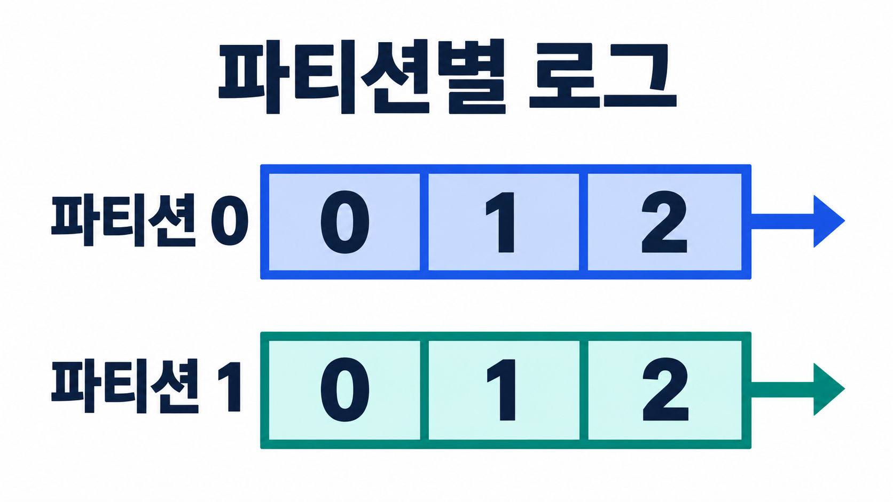

# Kafka 기초와 세팅: 토픽부터 복제까지

주문이 생성되면 결제를 처리하고, 재고를 갱신하고, 알림을 보내고, 분석용 데이터도 쌓아야 한다. 주문 서버가 이 작업들을 모두 직접 호출하면 연결 대상이 늘어날수록 장애와 지연의 영향도 커진다.

Kafka를 두면 주문 서버는 이벤트를 기록하고, 필요한 시스템들이 각자의 속도로 이벤트를 읽도록 구성할 수 있다. 이 구조를 이해하는 출발점은 **Kafka가 데이터를 보관하는 분산 로그이며, 파티션을 단위로 저장과 처리를 나눈다**는 점이다.

이 글에서는 주문 이벤트를 예로 토픽·파티션·오프셋, 디스크 저장 구조, 복제와 클러스터를 연결한 뒤 로컬에서 메시지를 주고받는 세팅까지 살펴본다.

## 1. Kafka를 사이에 두면 무엇이 달라질까

Apache Kafka는 이벤트를 발행하고, 저장하고, 구독해 처리하는 분산 이벤트 스트리밍 플랫폼이다. 이벤트는 “어떤 일이 일어났다”는 사실을 표현한다. 주문 생성, 결제 완료, 센서 측정값, 사용자 클릭 등이 그 예다.

주문 시스템에서는 다음과 같은 흐름을 만들 수 있다.

```text
주문 서비스 → orders 토픽 → 재고 처리 서비스
                         → 알림 서비스
                         → 매출 분석 서비스
```

이때 이벤트를 보내는 클라이언트가 **프로듀서**, 데이터를 보관하고 요청에 응답하는 Kafka 서버가 **브로커**, 이벤트를 읽는 클라이언트가 **컨슈머**다. 여러 브로커가 함께 동작하면 클러스터가 된다.

재고·알림·분석 서비스가 같은 이벤트 전체를 각각 읽어야 한다면 서로 다른 컨슈머 그룹으로 구성한다. 한 그룹 안에서는 여러 컨슈머가 파티션을 나눠 읽는다. 이 차이를 놓치면 “컨슈머를 여러 개 띄웠으니 모두 같은 메시지를 받겠지”라는 오해가 생긴다.

또한 컨슈머가 읽었다는 이유로 이벤트가 즉시 삭제되지 않는다. 보관 정책이 허용하는 범위에서는 다시 읽을 수 있다. 이 성질이 재처리와 여러 시스템의 독립적인 구독을 가능하게 한다. [Apache Kafka 소개](https://kafka.apache.org/41/getting-started/introduction/)

다만 장애가 사라지는 것은 아니다. 컨슈머가 오래 멈추면 처리해야 할 데이터가 쌓이고, 보관 기간이 지나면 아직 읽지 않은 이벤트도 삭제될 수 있다. Kafka를 도입한다는 것은 직접 호출의 결합을 줄이는 대신 **지연·저장 공간·재처리 정책을 운영한다**는 뜻이기도 하다.

## 2. 토픽·파티션·오프셋을 하나의 예제로 이해하기

### 토픽은 이름, 파티션은 실제로 나눠 저장하는 단위

`orders`라는 토픽에 주문 이벤트를 기록한다고 하자. 토픽은 관련 이벤트를 묶는 논리적 이름이다. 실제 데이터는 토픽 안의 파티션에 나뉘어 쌓인다.

```text
orders
  partition 0: 주문 A → 주문 C → 주문 E
  partition 1: 주문 B → 주문 D → 주문 F
```

파티션은 계속 뒤에 추가되는 로그로 생각하면 이해하기 쉽다. Kafka가 제공하는 순서는 **각 파티션의 로그 순서**다. 파티션 0의 주문 C와 파티션 1의 주문 D 중 어느 이벤트가 먼저 처리되어야 하는지까지 자동으로 정해 주지는 않는다.



*오프셋과 순서는 파티션별로 관리된다. 두 줄을 합친 전역 순서를 의미하지 않는다.*

### 오프셋은 파티션 안의 위치

오프셋은 파티션 안에서 레코드를 식별하는 숫자다. 따라서 `offset=2`만으로는 레코드 하나를 특정할 수 없다. 일반적으로 다음 세 값을 함께 봐야 한다.

```text
(topic, partition, offset)
(orders, 0, 2)
(orders, 1, 2)
```

마지막 두 레코드는 서로 다르다. 오프셋을 토픽 전체의 일련번호나 주문 ID로 사용하는 것은 잘못이다. 또 압축 정리나 트랜잭션 등의 영향으로 컨슈머에게 보이는 오프셋이 항상 연속적이라고 가정해서도 안 된다. [KafkaConsumer의 오프셋 설명](https://kafka.apache.org/41/javadoc/org/apache/kafka/clients/consumer/KafkaConsumer.html)

주문별 상태 변경을 같은 파티션에 모으고 싶다면 `order_id`를 키로 삼는 방법을 고려할 수 있다. 다만 같은 키의 라우팅은 파티셔너와 파티션 수에 영향을 받으므로, 파티션을 늘릴 때도 기존의 키별 순서 조건을 함께 검토해야 한다.

### 파티션 수와 복제 수는 서로 다른 설정이다

| 설정 | 바꾸는 것 | 주문 토픽에서의 의미 |
|---|---|---|
| 파티션 수 | 독립된 로그의 개수 | 데이터를 나누고 병렬 처리할 단위 |
| 복제 계수 | 각 파티션의 복사본 수 | 장애에 대비해 유지할 사본 개수 |

파티션 3개, 복제 계수 2라면 파티션 레플리카는 총 6개다. 복제 계수에는 리더 사본도 포함되므로 “원본 1개에 백업 2개”라는 뜻이 아니다. 단일 브로커에서는 복제 계수를 1로 두고 학습할 수 있지만 브로커 장애를 견디는 구성은 아니다.

## 3. 디스크에 저장하는데도 왜 처리량이 높을까

Kafka는 파티션 데이터를 디스크의 로그 파일에 보관한다. 성능을 이해할 때는 “디스크는 느리다”라는 구분보다 **어떻게 읽고 쓰는가**를 봐야 한다.

로그 끝에 이어 쓰면 임의 위치를 계속 고치는 작업을 줄일 수 있다. 여러 레코드를 배치로 묶으면 요청과 입출력 비용을 나눌 수 있고, 운영체제의 페이지 캐시도 활용할 수 있다. 따라서 Kafka의 높은 처리량을 “모든 데이터를 메모리에 보관하기 때문”이라고 설명하면 저장 구조를 놓치게 된다. [Kafka 설계: 저장과 효율성](https://kafka.apache.org/41/design/design/)

파티션의 로그는 다시 여러 **세그먼트**로 나뉜다. 파일 이름의 숫자는 보통 해당 세그먼트의 기준 오프셋을 나타낸다.

```text
orders-0/
  00000000000000000000.log
  00000000000000000000.index
  00000000000000000000.timeindex
  00000000000000001000.log
  ...
```

| 파일 | 역할 |
|---|---|
| `.log` | 실제 레코드 배치를 저장한다 |
| `.index` | 오프셋에서 로그 파일 내 위치를 찾는 데 사용한다 |
| `.timeindex` | 타임스탬프를 기준으로 탐색하는 데 사용한다 |

인덱스가 모든 메시지를 한 줄씩 기록한 표라고 가정할 필요는 없다. Kafka는 희소 인덱스를 이용하며, 인덱스로 근처 위치를 찾은 뒤 로그를 탐색한다. 위 디렉터리는 구조를 설명하기 위한 예시이며 실제 파일 수와 이름은 로그 상태에 따라 달라진다. [Kafka 로그 구현](https://kafka.apache.org/41/implementation/log/)

보관 정책도 저장 구조와 연결된다. 삭제 방식의 토픽은 시간이나 크기 조건에 따라 오래된 세그먼트를 정리하고, 로그 컴팩션은 키별 최신 상태를 유지하는 데 쓰인다. “Kafka에 넣으면 영구히 남는다”와 “읽으면 지워진다”는 설명 모두 보관 정책을 생략한 것이다. [토픽의 cleanup.policy와 retention 설정](https://kafka.apache.org/41/configuration/topic-configs/)

## 4. 복제와 리더는 장애에 어떻게 대응할까

파티션을 여러 브로커에 복제하면 각 사본을 **레플리카**라고 부른다. 일반적인 쓰기 요청은 해당 파티션의 리더가 받고, 팔로워가 리더의 로그를 복제한다.

예를 들어 세 브로커에 다음처럼 역할을 나눌 수 있다.

| 파티션 | 브로커 1 | 브로커 2 | 브로커 3 |
|---|---|---|---|
| orders-0 | 리더 | 팔로워 | 팔로워 |
| orders-1 | 팔로워 | 리더 | 팔로워 |
| orders-2 | 팔로워 | 팔로워 | 리더 |

이 표는 역할 배치 예시다. 리더는 클러스터 전체에 하나가 아니라 **파티션마다 하나**가 있다. 브로커 하나가 어떤 파티션에서는 리더이고 다른 파티션에서는 팔로워일 수 있다.

여기서 ISR(In-Sync Replicas)은 리더의 복제를 정상적으로 따라가는 사본 집합을 뜻하며 리더 자신도 포함한다. 복제 계수는 만들어 둔 사본 수이고, ISR은 현재 동기화 상태를 나타내므로 두 수가 항상 같지는 않다.

리더가 사라지면 컨트롤러가 선출 정책에 따라 새 리더를 결정한다. 충분히 복제되지 않은 사본을 리더로 허용하면 서비스가 다시 열리더라도 기존 레코드 일부가 사라질 위험이 있다. `unclean.leader.election.enable`은 이처럼 가용성과 데이터 보존 사이의 선택에 영향을 준다. “살아 있는 브로커 중 가장 최신 사본을 무조건 고른다”는 규칙으로 이해하면 안 된다. [Kafka 복제와 장애 처리 설계](https://kafka.apache.org/41/design/design/)

브로커 수만 늘린다고 무조건 안전해지는 것도 아니다. 복제 계수, 동기화 상태, 프로듀서의 확인 응답 조건, 장애 범위를 함께 봐야 한다.

## 5. ZooKeeper와 KRaft는 세팅부터 구분하기

Kafka의 **컨트롤러**는 브로커 등록, 파티션 메타데이터, 리더 변경 등 클러스터의 관리 작업을 담당한다. 이것은 메시지를 소비하는 클라이언트나 컨슈머 그룹 코디네이터와 다른 역할이다.

과거 ZooKeeper 기반 구성에서는 외부 ZooKeeper가 메타데이터와 조정 기능에 관여했다. KRaft 구성에서는 Kafka의 컨트롤러 쿼럼이 메타데이터 로그를 관리한다. Kafka 4.x는 KRaft 기반이므로 ZooKeeper 서버를 먼저 띄우는 예제와 4.x 실행 명령을 섞으면 안 된다. [KRaft와 ZooKeeper의 차이](https://kafka.apache.org/41/getting-started/zk2kraft/)

이 글의 실행 예시는 **Apache Kafka 4.1.2 공식 이미지**로 고정한다. 버전 번호를 고정한 이유는 세팅을 재현할 때 이미지와 명령의 기준을 맞추기 위해서다. 새 환경을 구성할 때는 사용하는 버전의 문서를 함께 확인한다.

## 6. 로컬 Kafka에서 이벤트 주고받기

아래 명령은 Docker가 준비된 Linux·macOS 또는 WSL 터미널을 전제로 한다. 이 글에서는 공식 문서와 명령 구성을 대조했으며, 브로커를 직접 구동한 실행 결과는 제시하지 않는다.

### 브로커 실행

```bash
docker run -d --name kafka-learning \
  -p 127.0.0.1:9092:9092 \
  apache/kafka:4.1.2

docker logs -f kafka-learning
```

공식 이미지의 기본 단일 노드 KRaft 구성을 이용한다. 로그가 계속 보이는 것은 오류가 아니며 `Ctrl+C`로 로그 추적을 끝내도 `-d`로 실행한 컨테이너는 계속 동작한다. 포트 9092를 이미 쓰고 있거나 같은 컨테이너 이름이 존재하면 먼저 그 충돌을 확인한다. [공식 Docker 실행 안내](https://kafka.apache.org/41/getting-started/docker/)

이 구성은 로컬 개념 확인용이다. 복제 계수 1이고 별도 영속 볼륨도 지정하지 않았으므로 운영용 고가용성 구성이나 데이터 보관 구성을 검증하는 예제로 해석하지 않는다.

### 토픽 생성과 구조 확인

브로커가 준비된 뒤 다음 명령을 실행한다.

```bash
docker exec kafka-learning /opt/kafka/bin/kafka-topics.sh \
  --bootstrap-server localhost:9092 \
  --create --topic orders \
  --partitions 3 --replication-factor 1

docker exec kafka-learning /opt/kafka/bin/kafka-topics.sh \
  --bootstrap-server localhost:9092 \
  --describe --topic orders
```

확인할 것은 토픽 이름, 파티션 수 3, 복제 계수 1, 각 파티션의 리더와 ISR이다. 리더의 실제 ID는 환경에 따라 달라질 수 있다.

### 키와 값을 함께 보내기

터미널 A에서 프로듀서를 연다.

```bash
docker exec -it kafka-learning \
  /opt/kafka/bin/kafka-console-producer.sh \
  --bootstrap-server localhost:9092 --topic orders \
  --property parse.key=true --property key.separator=:
```

아래 두 줄을 입력한다. 이 예제에서 콜론 앞은 키이고 뒤는 문자열 값이다.

```text
order-A:created
order-A:paid
```

터미널 B에서는 컨슈머를 실행한다.

```bash
docker exec -it kafka-learning \
  /opt/kafka/bin/kafka-console-consumer.sh \
  --bootstrap-server localhost:9092 --topic orders \
  --group orders-console-v1 --from-beginning \
  --property print.key=true \
  --property print.partition=true \
  --property print.offset=true
```

같은 키의 두 이벤트가 어느 파티션에 기록되었는지 확인해 보자. 특정 파티션 번호를 미리 정답으로 가정하지 말고 실제 출력에서 파티션과 오프셋을 읽는 것이 좋다. 토픽 생성과 콘솔 생산·소비의 기본 흐름은 [공식 Quick Start](https://kafka.apache.org/41/getting-started/quickstart/)를 참고할 수 있다.

`--from-beginning`을 붙여도 같은 그룹에 유효한 커밋 오프셋이 있으면 그 위치에서 재개한다. 처음부터 확인하려면 별도의 새 그룹 ID를 사용하고, 남아 있는 데이터의 범위도 확인해야 한다.

Docker 없이 직접 실행하려면 Kafka 4.1.2 바이너리와 Java 17 이상을 준비한 뒤 같은 버전의 KRaft 초기화 절차를 따른다. 로그 디렉터리 포맷은 최초 초기화 단계이며, 정상 실행을 위해 매번 반복하는 작업으로 사용하면 안 된다.

## 7. 접속 오류가 나면 포트보다 먼저 주소의 관점을 확인하기

컨테이너와 호스트가 섞이면 `localhost`의 의미가 달라진다.

| 클라이언트를 실행하는 위치 | `localhost`가 가리키는 곳 |
|---|---|
| 호스트의 Python 프로그램 | 호스트 자신 |
| Kafka 컨테이너 안의 CLI | 그 Kafka 컨테이너 |
| 별도 애플리케이션 컨테이너 | 그 애플리케이션 컨테이너 |

따라서 별도 컨테이너에서 Kafka에 접근할 때 `localhost:9092`를 그대로 쓰면 자기 컨테이너를 찾게 된다. 같은 Docker 네트워크의 서비스 이름과 내부 리스너 주소를 사용하는 구성이 필요하다.

또 `bootstrap.servers`는 처음 접속할 브로커를 알려 주는 설정이다. 클라이언트는 이후 메타데이터에서 실제 브로커 주소를 받아 접속한다. 첫 연결이 되어도 나중에 실패한다면 **브로커가 알린 주소에 클라이언트가 접근할 수 있는지** 살펴봐야 한다.

`listeners`는 브로커가 연결을 받는 주소이고, `advertised.listeners`는 클라이언트에게 안내하는 주소다. 모든 인터페이스에 바인딩하는 `0.0.0.0`과 클라이언트가 실제로 찾아갈 주소도 구분한다. [Kafka 리스너 설정](https://kafka.apache.org/41/security/listener-configuration/)

처음 Kafka를 살펴볼 때는 `토픽 이름 → 파티션 번호 → 오프셋 → 리더와 복제 상태` 순서로 확인하면 데이터가 어디에 있고 어떻게 읽히는지 연결하기 쉽다. 다음 단계에서는 이 로그에 데이터를 쓰는 프로듀서와 처리 위치를 관리하는 컨슈머의 동작을 더 자세히 살펴보면 된다.
