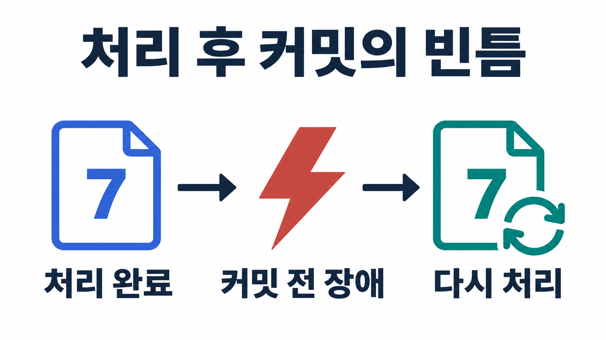

# Kafka 프로듀서와 컨슈머: acks·멱등성·커밋

Kafka에서 `send()`나 `produce()`를 호출했다고 곧바로 업무 처리가 끝난 것은 아니다. 프로듀서가 전송을 준비한 시점, 브로커가 레코드를 받아들인 시점, 컨슈머가 업무를 처리한 시점, 처리 위치를 커밋한 시점은 서로 다르다.

중복과 누락을 이해하려면 이 경계를 나눠 봐야 한다. 이 글에서는 `orders` 토픽의 주문 이벤트를 예로 **프로듀서의 전송·확인 응답·멱등성, 컨슈머의 그룹·리밸런싱·커밋**을 연결하고 Python 예제로 마무리한다.

## 1. 프로듀서는 레코드를 어떻게 보내는가

프로듀서는 애플리케이션의 데이터를 Kafka 레코드로 만들어 보낸다. 레코드에는 토픽, 키, 값, 선택적인 파티션·타임스탬프·헤더 등이 들어갈 수 있다.

```text
topic: orders
key: order-A
value: {"event_id": "evt-001", "status": "created"}
```

여기서 `key`는 주문별 이벤트를 같은 파티션으로 모으는 기준으로 쓸 수 있고, `event_id`는 개별 이벤트를 식별하는 데 쓸 수 있다. 키와 이벤트 ID의 역할을 분리하면 “같은 주문의 다른 이벤트”와 “같은 이벤트의 재전달”을 구분하기 쉽다.

값이 반드시 문자열이어야 하는 것은 아니다. Kafka는 바이트를 저장하므로 애플리케이션은 문자열·JSON·Avro 등의 데이터를 바이트로 **직렬화**하고, 컨슈머는 약속한 형식으로 **역직렬화**한다. 키와 값의 스키마·인코딩이 맞지 않으면 브로커에 정상 저장된 데이터도 소비 단계에서 해석하지 못한다.

또한 null 값을 항상 오류로 취급해서는 안 된다. 로그 컴팩션 토픽에서 키와 null 값의 조합은 삭제를 나타내는 tombstone으로 사용될 수 있다. [Kafka 로그 컴팩션 설계](https://kafka.apache.org/41/design/design/)

### Java 프로듀서의 내부 흐름과 Python API 이름 구분하기

Java `KafkaProducer`의 흐름은 다음처럼 이해할 수 있다.

```text
레코드 생성 → 직렬화 → 파티션 결정
            → 파티션별 배치 버퍼 → 전송 스레드 → 브로커
```

`send()`는 기본적으로 비동기 API다. 호출 즉시 브로커 응답까지 기다리는 대신 전송 결과를 확인할 Future를 반환한다. Future의 완료를 기다리거나 콜백으로 결과를 받는 방식이 가능하다. 단, 메타데이터나 버퍼 공간을 기다리는 등 호출 자체가 대기할 수 있는 조건도 있다. [KafkaProducer API](https://kafka.apache.org/41/javadoc/org/apache/kafka/clients/producer/KafkaProducer.html)

뒤에서 사용할 Python `confluent-kafka`는 librdkafka 기반이며 `produce()`·`poll()`·`flush()`를 사용한다. Java의 `RecordAccumulator`·`buffer.memory` 같은 내부 구조와 설정 이름을 모든 클라이언트에 그대로 대입하지 않는다.

## 2. 어떤 파티션에 들어가는지 결정하는 기준

일반적인 Java 기본 파티셔닝에서는 명시적인 파티션 지정, 키 유무, 파티셔너 설정을 함께 본다.

| 조건 | 이해할 점 |
|---|---|
| 파티션을 직접 지정 | 지정한 파티션으로 보낸다 |
| 파티션 미지정, 키 있음 | 기본 설정에서는 키 해시를 기준으로 파티션을 고른다 |
| 파티션·키 모두 없음 | 기본 구현은 배치 효율을 위한 sticky 방식 등을 사용한다 |

키 없는 레코드를 무조건 `0 → 1 → 2 → 0` 순서로 돌려 보낸다고 외우면 실제 동작과 어긋날 수 있다. 사용자 정의 파티셔너나 클라이언트 라이브러리의 기본값도 확인해야 한다. [Java 프로듀서의 partitioner 설정](https://kafka.apache.org/41/configuration/producer-configs/)

`order-A`의 `created → paid → shipped`를 같은 파티션에 모으면 그 파티션의 로그 순서를 이용할 수 있다. 하지만 키가 같다는 이유만으로 여러 프로듀서의 업무상 발생 순서까지 자동으로 정렬되지는 않는다. 파티션 수를 늘리면 키의 목적지가 바뀔 수 있고, 컨슈머가 병렬 업무 처리를 하면 완료 순서도 달라질 수 있다.

순서가 중요하다면 키 선택, 파티션 수 변경, 프로듀서 재시도 설정, 컨슈머 처리 방식을 하나의 조건으로 검토해야 한다.

## 3. 배치는 처리량과 지연 사이의 선택이다

레코드마다 네트워크 요청을 보내면 작은 메시지에도 요청 비용이 반복된다. 프로듀서는 같은 파티션으로 갈 레코드를 배치로 묶고 압축해 효율을 높일 수 있다.

Java 프로듀서에서 자주 함께 보는 설정은 다음과 같다.

| 설정 | 의미 | 무작정 키웠을 때 살펴볼 점 |
|---|---|---|
| `batch.size` | 파티션별 배치를 모으는 크기 기준 | 작은 트래픽에서 기대만큼 채워지지 않을 수 있다 |
| `linger.ms` | 배치를 더 모으기 위해 기다리는 시간 | 처리량 이득과 지연을 함께 봐야 한다 |
| `buffer.memory` | 프로듀서 버퍼에 사용할 메모리 예산 | 무한 대기열이나 전체 프로세스 메모리 상한은 아니다 |
| `compression.type` | 배치 압축 방식 | CPU 비용과 네트워크·저장량을 함께 측정한다 |

크기와 시간이 충족될 때만 전송된다는 엄격한 규칙으로 이해할 필요는 없다. 같은 브로커로 요청을 만들면서 덜 찬 배치를 함께 보내는 등 실제 전송에는 다른 조건도 관여한다. 또한 **배치는 파티션별 단위이고 한 요청에 여러 배치가 포함될 수 있다**. [프로듀서 배치와 버퍼 설명](https://kafka.apache.org/41/javadoc/org/apache/kafka/clients/producer/KafkaProducer.html)

초기에는 기본 설정에서 시작하고, 메시지 크기·초당 유입량·허용 지연을 측정한 뒤 조정하는 편이 이해하기 쉽다. 단순히 배치를 크게 만드는 것은 실시간 요구를 만족한다는 증거가 아니다.

## 4. 동기·비동기 호출과 acks는 다른 질문이다

동기·비동기는 **호출자가 결과를 어떻게 기다리는가**, `acks`는 **브로커의 어느 확인을 성공 조건으로 삼는가**에 관한 구분이다. 비동기 전송에서도 `acks=all`을 사용할 수 있다.

| 설정 | 확인하는 범위 | 주요 위험 |
|---|---|---|
| `acks=0` | 브로커 응답을 기다리지 않는다 | 실제 수신 여부를 확인하지 못한다 |
| `acks=1` | 리더가 로컬 로그에 기록한 응답을 기다린다 | 팔로워 복제 전 리더 장애가 나면 유실 가능성이 있다 |
| `acks=all` 또는 `-1` | 현재 ISR의 복제를 기다린다 | 최소 ISR 등 관련 정책을 함께 확인해야 한다 |

여기서 `all`은 클러스터의 모든 브로커를 뜻하지 않는다. 해당 파티션의 현재 ISR을 대상으로 한다. [acks와 멱등성의 설정 조건](https://kafka.apache.org/41/configuration/producer-configs/)

예를 들어 복제 계수 3, `min.insync.replicas=2`, `acks=all`인 일반적인 구성을 생각해 보자. 동기화 사본이 부족하면 정상 쓰기를 계속 허용하기보다 오류로 돌려보내 데이터 보존 조건을 지키도록 설계할 수 있다. `min.insync.replicas=2`는 ISR 개수를 정확히 2개로 고정하는 옵션이 아니며, ISR이 3개인 상태에서 “아무 2개만 확인하면 된다”는 의미도 아니다. [min.insync.replicas 설명](https://kafka.apache.org/41/configuration/topic-configs/)

이 선택은 가용성과 연결된다. 사본이 부족해 쓰기를 거절하는 상황을 애플리케이션이 어떻게 처리할지까지 정해야 한다.

## 5. 멱등성은 재시도 중복의 범위를 이해해야 한다

프로듀서가 레코드를 보냈고 브로커가 저장했는데, 성공 응답만 네트워크에서 사라졌다고 하자. 프로듀서는 저장 성공 여부를 확신할 수 없어 재시도할 수 있다. 이때 같은 레코드가 두 번 저장되는 문제가 생긴다.

멱등성 프로듀서는 프로듀서 식별자와 시퀀스 등을 이용해 **프로듀서 내부 재시도로 생기는 중복 기록**을 방지한다. Java 클라이언트에서는 `enable.idempotence`, `acks`, 재시도, 진행 중 요청 수의 호환 조건을 함께 확인해야 한다.

하지만 애플리케이션이 동일한 결제 이벤트를 별개의 `produce()` 호출로 두 번 만들었다면 이야기가 다르다. 멱등성 옵션 하나가 두 호출을 같은 업무 이벤트로 판단해 주지는 않는다. 프로듀서 재시도 중복, 애플리케이션 중복 발행, 컨슈머 재처리 중복을 구분해야 한다. [KafkaProducer의 멱등성 범위](https://kafka.apache.org/41/javadoc/org/apache/kafka/clients/producer/KafkaProducer.html)

## 6. 컨슈머 그룹은 파티션을 나누는 단위다

일반 컨슈머는 브로커에 데이터를 요청해 가져오는 pull 방식으로 동작한다. `poll()` 호출과 네트워크 fetch, 애플리케이션 처리가 연결되지만, `poll()` 한 번이 네트워크 요청 한 번 또는 레코드 한 개와 항상 일치하는 것은 아니다.

구독 기반의 일반 컨슈머 그룹에서는 한 파티션을 같은 그룹의 한 컨슈머가 맡는다. 예를 들어 `orders`가 3개 파티션이면 다음과 같은 배치가 가능하다.

| 그룹의 컨슈머 수 | 가능한 분담 예시 |
|---|---|
| 1개 | C1이 P0·P1·P2 담당 |
| 2개 | C1이 P0·P1, C2가 P2 담당 |
| 3개 | 각 컨슈머가 한 파티션씩 담당 |
| 4개 | 해당 토픽만 구독한다면 적어도 하나는 할당받지 못함 |

서로 다른 그룹인 `inventory-workers`와 `analytics-workers`는 각자의 진행 위치를 관리하며 같은 토픽을 각각 읽을 수 있다. 그룹 ID는 단순히 프로그램 이름을 붙이는 장식이 아니라 **분담과 재시작 위치를 결정하는 식별자**다. 이 설명은 일반 컨슈머 그룹을 기준으로 하며 수동 파티션 할당이나 별도 share consumer 방식은 범위에 포함하지 않는다. [KafkaConsumer의 그룹 설명](https://kafka.apache.org/41/javadoc/org/apache/kafka/clients/consumer/KafkaConsumer.html)

### 리밸런싱이 일어나는 이유

컨슈머가 추가·종료되거나 구독한 파티션 구성이 바뀌면 담당 파티션을 다시 배정해야 한다. 이것이 리밸런싱이다. 그룹 코디네이터는 그룹 멤버십과 조정을 담당하는 브로커 측 역할이다.

기존 설명에서 자주 등장하는 Range·RoundRobin·Sticky는 일반 컨슈머의 할당 전략이다. Range는 토픽별로 범위를 나누고, RoundRobin은 구독 조건 안에서 파티션을 순환 배정하며, Sticky는 균형을 맞추면서 기존 할당의 이동을 줄이려 한다.

다만 모든 리밸런싱이 반드시 전체 파티션을 한꺼번에 회수하고, 가장 먼저 응답한 컨슈머를 리더로 뽑는 고정 절차를 따르는 것은 아니다. eager/cooperative 방식과 그룹 프로토콜에 따라 조정 과정이 다르다. 버전과 설정을 생략한 도식 하나로 현재 모든 동작을 설명하면 안 된다. [컨슈머의 group.protocol과 할당 전략 설정](https://kafka.apache.org/41/configuration/consumer-configs/)

## 7. 읽은 위치와 커밋한 위치가 다른 이유

컨슈머가 파티션 0에서 오프셋 7을 읽었다고 하자. 메모리상의 다음 읽기 위치는 앞으로 움직일 수 있지만, 그 레코드로 해야 할 업무가 성공했다는 뜻은 아니다.

커밋은 재시작할 때 사용할 위치를 저장하는 작업이다. **오프셋 7까지 처리가 끝났다면 다음에 읽을 위치인 8을 커밋한다.** 커밋 자체가 외부 DB 저장이나 결제 처리의 성공 여부를 검사해 주는 것은 아니다. [컨슈머 위치와 커밋의 차이](https://kafka.apache.org/41/javadoc/org/apache/kafka/clients/consumer/KafkaConsumer.html)



*오프셋 7의 업무는 끝났지만 다음 위치 8을 커밋하기 전에 중단되면, 재시작 후 7이 다시 전달될 수 있다.*

### 처리 전에 커밋하면 누락 가능성이 생긴다

```text
오프셋 8 커밋 → 업무 처리 전 장애 → 재시작 후 7 건너뜀
```

커밋 직후 실제 처리 전에 멈추면 재시작 위치는 이미 8이다. 7의 업무가 완료되지 않았어도 자동 재전달되지 않을 수 있다. 이 실패 구간이 at-most-once 처리의 위험이다.

### 처리 후 커밋하면 중복 가능성이 생긴다

```text
오프셋 7의 업무 처리 → 8을 커밋하기 전 장애 → 7 재처리
```

재시작 위치가 여전히 7이면 같은 이벤트를 다시 처리할 수 있다. 처리 후 커밋하는 at-least-once 방식에서는 이 중복을 업무 계층에서 감당해야 한다.

예를 들어 `event_id=evt-001`을 DB의 유일 키로 기록하거나, 같은 이벤트를 재처리해도 결과가 달라지지 않는 저장 방식을 고려할 수 있다. 단, 중복 확인 기록과 실제 업무 변경을 따로 저장해 그 사이에 장애가 생긴다면 다시 틈이 생긴다. 두 작업을 같은 DB 트랜잭션 안에서 다룰 수 있는지 검토해야 한다. [Kafka 메시지 처리 보장 설계](https://kafka.apache.org/41/design/design/)

자동 커밋도 이 경계를 없애지 못한다. 데이터를 가져온 뒤 별도 작업 큐에 넘기는 구조에서는 업무 완료보다 먼저 커밋될 수 있다. 수동 커밋 역시 잘못된 위치를 저장하면 안전하지 않다.

### earliest는 매번 처음부터 읽으라는 명령이 아니다

`auto.offset.reset=earliest`는 유효한 초기 커밋 위치가 없거나 저장된 위치를 더 이상 사용할 수 없을 때 시작점을 선택하는 정책이다. 기존 그룹에 유효한 커밋이 있으면 그 위치에서 이어 간다. 남아 있는 레코드 중 가장 이른 위치로 이동하므로 삭제된 데이터가 복구되는 것도 아니다. [auto.offset.reset 설명](https://kafka.apache.org/41/configuration/consumer-configs/)

## 8. Python으로 전송 결과와 처리 후 커밋 연결하기

다음 코드는 `localhost:9092`에서 Kafka가 실행 중이고 `orders` 토픽이 존재한다는 전제다. 설명을 명확히 하기 위해 `confluent-kafka` 하나로 통일한다. `kafka-python`의 `KafkaProducer`, `bootstrap_servers`와 이 라이브러리의 `Producer`, `bootstrap.servers`는 서로 다른 API이므로 섞어 쓰지 않는다.

```bash
python3 -m venv .venv
source .venv/bin/activate
python -m pip install confluent-kafka
```

설치 후에는 `python -m pip show confluent-kafka`로 버전을 기록하면 재현에 도움이 된다. 아래는 공식 API와 대조한 학습용 예제이며, 이 글에서는 실제 브로커와의 송수신 실행 결과로 제시하지 않는다. [Python 클라이언트 공식 안내](https://docs.confluent.io/kafka-clients/python/current/overview.html)

### 프로듀서: 큐 등록과 최종 전송 결과를 구분하기

```python
import json
from confluent_kafka import Producer

failures = []

def on_delivery(err, msg):
    if err is not None:
        failures.append(str(err))
    else:
        print("delivered", msg.partition(), msg.offset())

producer = Producer({
    "bootstrap.servers": "localhost:9092",
    "acks": "all",
    "enable.idempotence": True,
})

events = [
    {"event_id": "evt-001", "order_id": "order-A", "status": "created"},
    {"event_id": "evt-002", "order_id": "order-A", "status": "paid"},
]

for event in events:
    producer.produce(
        "orders",
        key=event["order_id"].encode("utf-8"),
        value=json.dumps(event, ensure_ascii=False).encode("utf-8"),
        on_delivery=on_delivery,
    )
    producer.poll(0)

remaining = producer.flush(10)
if remaining or failures:
    raise RuntimeError({"remaining": remaining, "failures": failures})
```

`produce()`가 정상 반환하면 우선 내부 큐에 등록된 것이다. 최종 성공·실패는 delivery 콜백으로 확인한다. `poll()`과 `flush()`는 콜백을 실행하는 데도 관여하며, `flush(10)`의 반환값은 제한 시간 후 남은 메시지 수다. 반환값이 0이어도 실패 콜백이 있었는지 확인해야 한다. 이 예제는 소량 전송용이며 대량 처리에서는 큐 포화에 대한 흐름 제어도 필요하다. [Producer API](https://docs.confluent.io/platform/current/clients/confluent-kafka-python/html/index.html)

### 컨슈머: 한 건의 업무가 끝난 뒤 다음 위치 저장하기

```python
import json
from confluent_kafka import Consumer, KafkaException

consumer = Consumer({
    "bootstrap.servers": "localhost:9092",
    "group.id": "orders-learning-v1",
    "auto.offset.reset": "earliest",
    "enable.auto.commit": False,
    "enable.auto.offset.store": False,
})

def process(event):
    # 학습용 처리. 실제 서비스에서는 업무 저장과 중복 방지를 구현한다.
    print("processed", event["event_id"], event["status"])

consumer.subscribe(["orders"])

try:
    while True:
        msg = consumer.poll(1.0)
        if msg is None:
            continue
        if msg.error():
            raise KafkaException(msg.error())

        event = json.loads(msg.value().decode("utf-8"))
        process(event)
        committed = consumer.commit(message=msg, asynchronous=False)
        for partition in committed:
            if partition.error is not None:
                raise KafkaException(partition.error)
except KeyboardInterrupt:
    pass
finally:
    consumer.close()
```

`commit(message=msg)`는 해당 메시지의 오프셋에 1을 더한 위치를 커밋한다. 동기 호출의 예외뿐 아니라 반환된 파티션별 `error`도 확인한다. 이 코드는 한 건씩 처리하고 동기 커밋하므로 흐름은 단순하지만 처리량에는 불리하다. [Consumer commit·TopicPartition API](https://docs.confluent.io/platform/current/clients/confluent-kafka-python/html/index.html)

`process()`가 실패하면 그 레코드를 커밋하지 않고 예외로 종료한다. 오류를 잡아 놓고 다음 레코드를 계속 처리·커밋하면 실패한 레코드를 건너뛰게 될 수 있기 때문이다. 실제 서비스에서는 재시도 한도, 실패 이벤트 격리, 리밸런싱 중 소유권 변경도 함께 설계한다.

또한 이 코드는 중복 제거를 구현하지 않는다. 출력이 성공한 직후 커밋 전 종료되면 같은 `event_id`가 다시 출력될 수 있다. 이것이 앞에서 설명한 처리 후 커밋의 경계다.

## 9. 컨슈머 랙과 exactly-once를 읽을 때의 기준

컨슈머 랙은 보통 파티션 끝의 위치와 컨슈머 진행 위치의 차이로 본다. 다만 도구가 읽기 위치를 쓰는지 커밋 위치를 쓰는지 확인해야 한다.

설명을 위해 로그 끝의 다음 오프셋이 120이고 커밋 위치가 100이라면, 두 위치의 차이는 20이다. 이것을 곧바로 “업무 처리까지 정확히 20건 남았다”로 해석해서는 안 된다. 오프셋의 빈 구간, 트랜잭션 가시성, 애플리케이션 내부 대기열이 있을 수 있다.

특정 파티션만 랙이 늘면 키 쏠림이나 느린 처리 경로를 먼저 살펴볼 수 있다. 반대로 Kafka에서 빠르게 읽어 내부 큐에만 쌓는다면 Kafka 랙이 낮아도 업무 지연은 커질 수 있다.

exactly-once도 보장 범위를 함께 봐야 한다. Kafka에서 읽어 다른 Kafka 토픽에 쓰는 처리에서는 출력 레코드와 입력 오프셋을 같은 트랜잭션에 묶고, 후속 컨슈머가 `read_committed`로 읽도록 구성하는 방식이 있다. 프로듀서의 멱등성만 켠 것과는 다르다.

외부 DB 저장이나 결제 API 호출까지 포함하면 해당 시스템과의 원자성·멱등성 설계가 추가로 필요하다. “Kafka가 exactly-once를 지원한다”는 문장을 전체 업무의 중복이 사라진다는 뜻으로 확대하면 안 된다. [Kafka 트랜잭션과 외부 시스템의 경계](https://kafka.apache.org/41/design/design/)

설정을 고를 때는 “얼마나 빠르게 보낼까”와 함께 **어디까지 성공으로 볼 것인지, 장애 후 어디서 다시 시작할 것인지, 같은 이벤트가 다시 와도 안전한지**를 먼저 정해야 한다.
